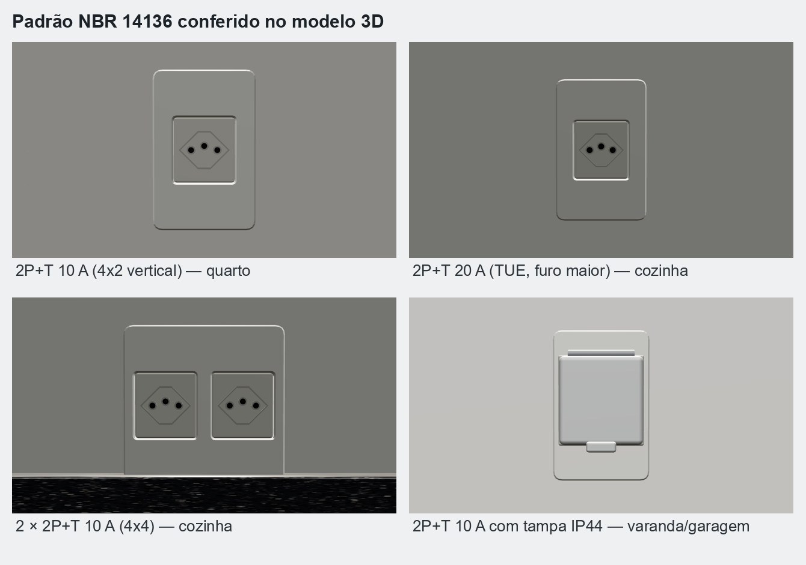
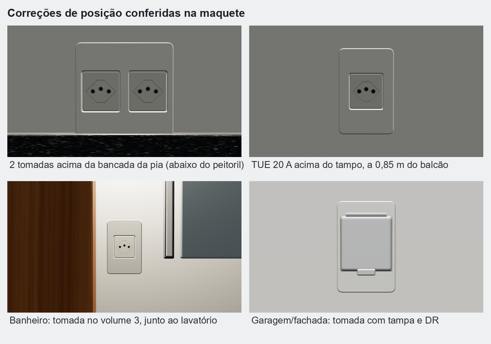

# Verificação das tomadas e da parte elétrica — ABNT NBR 5410 e NBR 14136

**Objeto:** maquete 3D navegável da casa (`casa-3d.html`, planta 7,37 × 18,45 m, pé-direito
2,80 m). **Data:** 27/11/2026.

**Pergunta:** as tomadas da casa estão no padrão brasileiro e a parte elétrica representada
(inclusive a instalação das tomadas) obedece à ABNT NBR 5410?

## 1. Resumo executivo

Sim, **depois das correções feitas nesta verificação**. A maquete representa **33 pontos de
tomada (36 tomadas)** no padrão **NBR 14136 (2P+T, 10 A e 20 A)** e a disposição dos pontos
atende aos critérios da **NBR 5410:2004** que podem ser conferidos em uma maquete 3D:
quantidade mínima por ambiente, duas tomadas acima da bancada da pia, volume 3 nos banheiros,
DR de 30 mA nos ambientes exigidos, TUE de 20 A em circuito independente e potência mínima
atribuível.

A verificação encontrou **5 não conformidades na representação**, todas corrigidas:

1. **Furos das tomadas fora do padrão NBR 14136** — o modelo desenhava o furo com o diâmetro
   do **pino** (4,0 mm / 4,8 mm) em vez do furo de entrada da tomada (**4,3 mm / 5,0 mm**) e
   colocava o **pino terra a 24,7 mm** da linha das fases (o padrão é **3 mm**), formando um
   “triângulo” largo que não corresponde à tomada brasileira.
2. **TUE de 20 A (micro-ondas/forno) instalado sob o tampo do balcão**, a 0,88 m, sem acesso
   para um equipamento de bancada.
3. **As duas tomadas da bancada da pia ficavam 10,5 cm fora da projeção do tampo** (ao lado da
   bancada), porque a janela ocupava a parede acima da cuba.
4. **Tomada do BWC social atrás da folha da porta** quando ela abre 85° (a porta abre contra a
   parede sul, onde ficava o ponto).
5. **Conferência interna inconsistente**: nomes de ambientes diferentes de `ROOMS`
   (`Sala`, `Sala de jantar`, `Circulação`, `Área de serviço`), mínimo da garagem contraditório
   e potência de 600 VA calculada de forma global em vez de por ambiente.

**O que não é possível afirmar:** circuitos, bitolas de condutores, disjuntores, seletividade,
DR real, esquema de aterramento, quadro de distribuição, interruptores e a instalação física
**não são modelados**. A maquete é uma representação visual: este documento verifica a
**representação** e os critérios de ponto que ela contém, **não** emite laudo de conformidade
de uma instalação real. Para a casa real é necessária inspeção presencial e ensaios por
profissional habilitado (ver §11 e §12).

## 2. Base normativa e método

### 2.1 Normas usadas

| Norma | Edição | Uso nesta verificação |
|---|---|---|
| **ABNT NBR 5410** — Instalações elétricas de baixa tensão | 2004 (versão corrigida, Errata 1 de 17/03/2008) | Critérios de quantidade, potência, DR, volumes de banheiro, TUE e aterramento das tomadas |
| **ABNT NBR 14136** — Plugues e tomadas para uso doméstico e análogo até 20 A/250 V | 2012 (Emenda 1 de 19/09/2012) | Dimensões e padrão dos furos, pinos, placas e compatibilidade 10 A/20 A |

A NBR 5410 foi lida no PDF indicado no pedido
(https://universidadeniltonlins.com.br/wp-content/uploads/2019/04/NBR-5410.pdf), extraído com
PyMuPDF (217 páginas). As cláusulas usadas estão citadas no §4 e transcritas no Anexo A. A
NBR 14136 foi conferida nas figuras normativas A.1, A.2, A.7 e A.8 (vistas frontal e cortes
da tomada e do plugue).

> **Nota sobre a edição:** a verificação usa a **NBR 5410:2004** (versão corrigida com a
> Errata 1 de 17/03/2008), que é a edição do PDF fornecido. A ABNT estava revisando a norma
> (consulta nacional encerrada em 27/02/2024); se uma nova edição já tiver sido publicada e
> estiver em vigor, os itens deste relatório devem ser reconferidos no texto novo.

### 2.2 Como foi verificado

1. **Leitura das normas** e extração do texto das cláusulas aplicáveis (NBR 5410).
2. **Auditoria geométrica automatizada** — `node .qa/outlets-audit.mjs` lê `ROOMS`, `WALLS`,
   `WINDOWS`, `DOORS`, `OUTLETS` e `OUTLET_KINDS` do próprio `casa-3d.html` e confere:
   área/perímetro de cada ambiente, mínimo por ambiente, 2 tomadas acima da pia, posição em
   parede, invasão de vãos de portas/janelas, obstrução por móveis, volumes 0–3 dos banheiros,
   TUE, DR, potência atribuível e a geometria NBR 14136. Sai com código 1 se algo falhar.
3. **Verificação visual** — close-ups de cada tipo de tomada e vistas dos ambientes no Edge
   (via CDP), para conferir o padrão brasileiro e a posição relativa a bancadas, espelhos,
   camas e eletrodomésticos.
4. **Conferência cruzada** das distâncias e da geometria com as plantas/cotas do projeto
   (paredes, janelas, box, mobiliário).

## 3. Resultado por critério da NBR 5410

| Cláusula | Critério (resumo) | Como foi verificado | Resultado |
|---|---|---|---|
| 9.5.2.2.1 a | Banheiro: ≥ 1 ponto junto ao lavatório, respeitando 9.1 | 1 ponto por banheiro, a 0,32 m do lavatório, em volume 3 | **Atende** |
| 9.5.2.2.1 b | Cozinha, copa, área de serviço e lavanderia: 1 ponto/3,5 m ou fração + ≥ 2 tomadas acima da bancada da pia | Cozinha: perímetro 19,68 m → 6 pontos; há 7. A. Serviço: 6,26 m → 2; há 2. Duas tomadas acima da pia (placa dupla) | **Atende** (ver §7) |
| 9.5.2.2.1 c | Varanda: ≥ 1 ponto | 1 ponto na varanda, a 0,45 m | **Atende** |
| 9.5.2.2.1 d | Sala e dormitórios: 1 ponto/5 m ou fração | Q2 14,06 m→3 (4); Q1 12,00 m→3 (4); suíte 14,06 m→3 (5); sala 15,30 m→4 (6) | **Atende** |
| 9.5.2.2.1 e | Demais cômodos: ≤ 2,25 m²→1; ≤ 6 m²→1; > 6 m²→1/5 m | Despensa 2,12 m²→1 (1) | **Atende** |
| 9.5.2.2.2 | Potência mínima por ponto (600 VA até 3 pontos nos molhados; 100 VA nos demais; com conjunto > 6 pontos, 600 VA até 2 por ambiente) | Calculado por ambiente e gravado em `OUTLETS[].va` | **Atende** (ver §6) |
| 4.2.1.2.3 c/d/e | TUE com potência do equipamento, a ≤ 1,5 m; vários equipamentos com tomadas suficientes | Único TUE (20 A) a 0,85 m do balcão; placa dupla onde faz sentido | **Atende** |
| 9.5.3.1 | Equipamento > 10 A: circuito independente | TUE marcado (`tue: true`) e tomada de 20 A; circuito não é modelado | **Atende na representação** |
| 9.1.2.1 / 9.1.4.3.1 | Banheiro: nenhum dispositivo nos volumes 0, 1 e 2 | Box delimitado por vidro em X = 0,98 m; tomadas a 2,65 m (volume 3) | **Atende** |
| 9.1.4.3.2 c | Tomada no volume 3 com DR ≤ 30 mA | `dr: true` nos dois banheiros | **Atende na representação** |
| 9.1.4.3.3 | Nenhuma tomada a < 0,60 m da porta de cabine pré-fabricada | Box é de alvenaria/vidro (não é cabine pré-fabricada); ainda assim as tomadas ficam a 1,47 m do vidro | **Não aplicável / atende por folga** |
| 5.1.3.2.2 | DR de 30 mA em banheiro, cozinha, área de serviço, garagem, áreas externas e internas que possam alimentar o exterior | 13 tomadas marcadas com `dr: true` nos 6 ambientes exigidos | **Atende na representação** |
| 6.5.3.1 | Todas as tomadas fixas com contato de aterramento (PE) | Todas as 33 tomadas têm 3 furos (2P+T) | **Atende na representação** |
| 9.5.2.1.1 | ≥ 1 ponto de luz fixo no teto por cômodo, comandado por interruptor | 44 luminárias em 13 zonas; todos os ambientes têm ponto de luz; interruptores não são modelados | **Ponto de luz: atende; interruptores: não representados** |

**Itens da NBR 5410 não verificáveis na maquete** (e que precisam constar do projeto
executivo): divisão da instalação em circuitos (9.5.3.2 e 4.2.5), seção dos condutores
(6.2), proteção contra sobrecorrente (6.3), DR e sua atuação (6.3.6), aterramento e
equipotencialização (5.1.2.2, 6.4 e 9.1.3), quadro de distribuição (6.5.4), marcação de
tensão quando houver circuitos de tensões diferentes (6.5.3.2), interruptores (9.5.2.1.1),
tomadas de piso e previsão de carga total (4.2.1).

## 4. Quantidade mínima por ambiente (NBR 5410 9.5.2.2.1)

Áreas e perímetros calculados pela união dos retângulos de `ROOMS` (o perímetro da cozinha é
o do contorno em L, 19,68 m, e não o do retângulo envolvente).

| Ambiente | Área (m²) | Perímetro (m) | Mínimo NBR 5410 | Pontos previstos | Situação |
|---|---:|---:|---:|---:|---|
| Quarto 02 | 12,09 | 14,06 | 3 | 4 | ok |
| Quarto 01 | 9,00 | 12,00 | 3 | 4 | ok |
| BWC social | 3,90 | 8,60 | 1 | 1 | ok |
| BWC suíte | 3,90 | 8,60 | 1 | 1 | ok |
| Suíte | 12,09 | 14,06 | 3 | 5 | ok |
| Cozinha | 15,80 planta | 19,68 | 6 | 7 | ok |
| Despensa | 2,12 | 6,06 | 1 | 1 | ok |
| A. Serviço | 2,32 | 6,26 | 2 | 2 | ok |
| Sala de estar/jantar | 13,62 planta | 15,30 | 4 | 6 | ok |
| Varanda | 6,33 | 11,20 | 1 | 1 | ok |
| Garagem (vaga descoberta) | 18,72 | 17,32 | sem mínimo (área externa) | 1 | ok, com DR |

**Total: 33 pontos e 36 tomadas** (três pontos são placas duplas 4x4: mesa de trabalho da
suíte, rack da sala e bancada da pia). Observações:

- **Cozinha** é um ambiente em L, integrado à passagem para os quartos; os 7 pontos incluem o
  ponto da passagem (`CR-GER`), que antes estava rotulado como “Circulação”. O mínimo é 6.
- **Sala de estar/jantar** é um único ambiente na planta (a norma não separa estar e jantar);
  os 6 pontos atendem ao mínimo de 4.
- **A. Serviço**: o nome agora é o mesmo de `ROOMS` (antes “Área de serviço” não casava e a
  conferência somava errado).
- **Garagem**: é a vaga descoberta em frente à varanda; não é cômodo coberto e não tem parede
  própria. O único ponto fica na fachada, junto à vaga, com tampa (IP44) e DR — coerente com
  5.1.3.2.2 d. A maquete não conta esse ponto como mínimo de cômodo.
- **Varanda**: tem área (6,33 m²) e profundidade (1,57 m) acima dos limites da exceção de
  9.5.2.2.1 c, então o ponto está na própria varanda.

## 5. Tomadas — relação completa

Legenda: `h` = altura do centro (m); DR = pertence a circuito com DR de 30 mA (metadado da
representação); VA = potência mínima atribuível pela 9.5.2.2.2; TUE = ponto de uso específico
(potência do equipamento).

| # | ID | Ambiente | Tipo | h | DR | VA |
|---:|---|---|---|---:|---|---:|
| 1 | Q2-CAB-1 | Quarto 02 | 2P+T 10 A | 0,55 | — | 100 |
| 2 | Q2-CAB-2 | Quarto 02 | 2P+T 10 A | 0,55 | — | 100 |
| 3 | Q2-TV | Quarto 02 | 2P+T 10 A | 1,25 | — | 100 |
| 4 | Q2-GER | Quarto 02 | 2P+T 10 A | 0,30 | — | 100 |
| 5 | Q1-CAB-1 | Quarto 01 | 2P+T 10 A | 0,55 | — | 100 |
| 6 | Q1-CAB-2 | Quarto 01 | 2P+T 10 A | 0,55 | — | 100 |
| 7 | Q1-TV | Quarto 01 | 2P+T 10 A | 1,25 | — | 100 |
| 8 | Q1-GER | Quarto 01 | 2P+T 10 A | 0,30 | — | 100 |
| 9 | ST-CAB-1 | Suíte | 2P+T 10 A | 0,55 | — | 100 |
| 10 | ST-CAB-2 | Suíte | 2P+T 10 A | 0,55 | — | 100 |
| 11 | ST-MESA | Suíte | 2 × 2P+T 10 A (4x4) | 1,05 | — | 100 |
| 12 | ST-TV | Suíte | 2P+T 10 A | 1,25 | — | 100 |
| 13 | ST-GER | Suíte | 2P+T 10 A | 0,30 | — | 100 |
| 14 | BS-LAV | BWC social | 2P+T 10 A | 1,20 | sim | 600 |
| 15 | BE-LAV | BWC suíte | 2P+T 10 A | 1,20 | sim | 600 |
| 16 | CZ-GELADEIRA | Cozinha | 2P+T 10 A | 0,30 | sim | 600 |
| 17 | CZ-BANCADA | Cozinha | 2 × 2P+T 10 A (4x4) | 1,02 | sim | 600 |
| 18 | CZ-GER-2 | Cozinha | 2P+T 10 A | 1,10 | sim | 100 |
| 19 | CZ-COIFA | Cozinha | 2P+T 10 A | 2,05 | sim | 100 |
| 20 | CZ-AMERICANA | Cozinha | **2P+T 20 A** | 1,10 | sim | TUE |
| 21 | CZ-GER | Cozinha | 2P+T 10 A | 0,30 | sim | 100 |
| 22 | SL-TV | Sala de estar/jantar | 2P+T 10 A | 1,25 | — | 100 |
| 23 | SL-RACK | Sala de estar/jantar | 2 × 2P+T 10 A (4x4) | 0,30 | — | 100 |
| 24 | SL-REDE | Sala de estar/jantar | 2P+T 10 A | 0,30 | — | 100 |
| 25 | SL-SOFA | Sala de estar/jantar | 2P+T 10 A | 0,45 | — | 100 |
| 26 | SL-GER | Sala de estar/jantar | 2P+T 10 A | 0,30 | — | 100 |
| 27 | SJ-GER | Sala de estar/jantar | 2P+T 10 A | 0,30 | — | 100 |
| 28 | AS-MAQUINA | A. Serviço | 2P+T 10 A | 1,10 | sim | 600 |
| 29 | AS-FERRO | A. Serviço | 2P+T 10 A | 1,10 | sim | 600 |
| 30 | DS-GER | Despensa | 2P+T 10 A | 0,30 | — | 100 |
| 31 | CR-GER | Cozinha (passagem) | 2P+T 10 A | 0,30 | sim | 100 |
| 32 | VR-LUZ | Varanda | 2P+T 10 A com tampa (IP44) | 0,45 | sim | 100 |
| 33 | GR-GER | Garagem (fachada) | 2P+T 10 A com tampa (IP44) | 0,60 | sim | 100 |

## 6. Potência atribuível e DR (NBR 5410 9.5.2.2.2 e 5.1.3.2.2)

- **Molhados** (banheiros, cozinha, área de serviço) somam 11 pontos; como o conjunto tem
  mais de 6 pontos, admite-se 600 VA por ponto **até 2 pontos por ambiente** e 100 VA nos
  excedentes, sempre considerando cada ambiente separadamente. Resultado: 6 pontos com
  600 VA (1 em cada banheiro, 2 na cozinha, 2 na área de serviço) e os demais com 100 VA.
- **Demais ambientes**: 100 VA por ponto.
- **TUE**: `CZ-AMERICANA` (20 A) recebe a potência do equipamento, não 100 VA.
- **DR de 30 mA**: 13 tomadas em banheiros (2), cozinha (7), área de serviço (2), varanda (1)
  e garagem/fachada (1). Nos quartos, suíte, sala e despensa não há exigência de DR pela
  5.1.3.2.2 — o que não impede o projetista de adotar DR geral no quadro (recomendado).

## 7. Correções de posição feitas na maquete

| Ponto | Antes | Depois | Por quê |
|---|---|---|---|
| `CZ-BANCADA` (2 tomadas da pia) | x = 7,24; y = 6,335; h = 1,10 — ao lado do tampo e acima dele, mas 10,5 cm fora da projeção da bancada | x = 7,24; y = 7,00; h = 1,02 — na parede **sob o peitoril** da janela da cuba, acima do tampo (0,89 m) e abaixo do peitoril (1,10 m) | 9.5.2.2.1 b exige 2 tomadas **acima da bancada da pia**; a janela não deixa parede livre acima do tampo, mas deixa sob o peitoril |
| `CZ-AMERICANA` (TUE 20 A) | x = 6,9; y = 9,121; h = 0,88 — sob o tampo de granito do balcão (1,05/1,09 m) | x = 7,24; y = 8,93; h = 1,10 — parede leste, acima do tampo, a 0,85 m do balcão | Ponto de uso específico precisa estar acessível e a ≤ 1,5 m do equipamento; sob o tampo não serve para micro-ondas/forno de bancada |
| `BS-LAV` (BWC social) | x = 2,65; y = 7,691 — atrás da folha da porta quando ela abre 85° | x = 2,45; y = 7,691 — entre o lavatório e a folha aberta (folga de ~8 cm para cada lado) | A porta P2 abre contra a parede sul do banheiro; a tomada ficava encoberta pela folha |
| `CR-GER` | rótulo “Circulação” (ambiente inexistente em `ROOMS`) | rótulo “Cozinha”, uso “passagem para os quartos, limpeza” | A passagem faz parte da cozinha em L na planta; a conferência passa a casar com o ambiente |
| `SL-*`, `SJ-GER` | rótulos “Sala”/“Sala de jantar” | “Sala de estar/jantar” | A planta tem **um** ambiente (13,62 m²); evita contar a sala duas vezes |
| `AS-*` | rótulo “Área de serviço” | “A. Serviço” | Mesmo nome de `ROOMS`, para a conferência automática |

A conferência interna (`OUTLET_RULES`/`outletReport()`) passou a ser **gerada a partir de
`ROOMS.a` e `ROOMS.p`**, sem lista duplicada nem “hack” de somar ambientes diferentes, e a
potência de 600 VA passou a ser contada **por ambiente** (antes era global).

## 8. NBR 14136 — o padrão brasileiro das tomadas

A tomada brasileira é **2P+T (dois polos + terra)**, com três furos redondos, superfície
protetora hexagonal e duas correntes nominais: **10 A** e **20 A**. A NBR 14136 fixa
(figuras A.1/A.2, A.7/A.8):

| Item | Valor normativo | Modelo **antes** | Modelo **depois** |
|---|---|---|---|
| Furo de entrada da tomada — 10 A | Ø 4,3 mm (+0,2/0) | Ø 4,0 mm | **Ø 4,3 mm** |
| Furo de entrada da tomada — 20 A | Ø 5,0 mm (+0,2/0) | Ø 4,8 mm | **Ø 5,0 mm** |
| Pino do plugue — 10 A | Ø 4,0 ± 0,05 mm | — (não modelado) | — (não modelado) |
| Pino do plugue — 20 A | Ø 4,8 ± 0,05 mm | — (não modelado) | — (não modelado) |
| Distância entre fases (centros) | 19 ± 0,2 mm | 19 mm | 19 mm |
| Terra em relação à linha das fases | **3 ± 0,15 mm** (quase alinhado) | **24,7 mm** (triângulo largo) | **3,0 mm** |
| Superfície protetora | hexagonal, aprox. 37 ± 0,5 × 28 ± 0,5 mm, R5 | retangular, sem hexágono | **hexagonal 37 × 28 mm** |
| Compatibilidade | tomada 20 A aceita plugue 10 A; tomada 10 A **não** aceita plugue 20 A | furo 4,8 mm não representava a aceitação | furo 5,0 mm aceita o plugue de 10 A e diferencia fisicamente |
| Placa | 4x2 (72 × 114 mm) / 4x4 (114 × 114 mm); parafuso na placa | parafuso sobre a face do soquete | parafuso na placa, abaixo da janela do módulo |

Observações:

- O **Ø 4,0 mm / 4,8 mm** que aparece em textos de mercado é o do **pino do plugue**, não o
  do furo da tomada. A tomada precisa de folga (4,3/5,0 mm) para o pino entrar e para a
  tomada de 20 A aceitar também o plugue de 10 A.
- A imagem do padrão é o “encaixe hexagonal” com os três furos quase alinhados — **não** é o
  triângulo largo que estava modelado.
- As placas são **4x2 vertical** e **4x4** (duas tomadas lado a lado), com acabamento branco
  acetinado; as tomadas externas têm **tampa articulada** (IP44), como nos pontos da varanda e
  da garagem.
- Alturas **não são fixadas pela norma**. As usadas (0,30; 0,55; 1,02; 1,10; 1,20; 1,25;
  2,05 m) são usuais e apenas de representação.

## 9. Banheiros e os volumes da NBR 5410 (9.1)

Cada banheiro tem 3,90 m² e o box de vidro ocupa a faixa oeste, com o vidro no plano
X = 0,98 m (o chuveiro fica a 0,555 m da parede). Aplicando 9.1.2.1:

- **volume 0**: interior do box/piso do box (X < 0,98 m);
- **volume 1**: até o vidro que delimita o box, até 2,25 m de altura;
- **volume 2**: faixa de 0,60 m além do vidro (0,98 a 1,58 m);
- **volume 3**: faixa seguinte de 2,40 m (1,58 a 3,98 m) e até 2,25 m de altura.

As tomadas `BS-LAV` e `BE-LAV` ficam em **X = 2,45 m (BWC social) e 2,65 m (BWC suíte)**, ou
seja, **1,47 m e 1,67 m além do vidro**, dentro do volume 3, a 1,20 m de altura (abaixo de
2,25 m) e a ~0,33 m do lavatório. Portanto: **nenhuma tomada nos volumes 0, 1 e 2**; tomada no
volume 3 atendendo 9.1.4.3.2 c (com DR de 30 mA, metadado `dr: true`). A regra de 0,60 m da
porta de cabine pré-fabricada (9.1.4.3.3) não se aplica (o box é de alvenaria/vidro), e a
folga é de mais de 1,4 m de qualquer forma. No BWC social o ponto foi deslocado de X = 2,65
para X = 2,45 m para não ficar atrás da folha da porta quando ela abre (ver §7).

## 10. O que mais foi verificado e o que ficou de fora

**Verificado e conforme na representação:**

- todos os 33 pontos estão em parede (nenhum flutuando ou atravessando parede);
- nenhuma placa invade vão de porta/janela (folga mínima encontrada: 0,09 m no `Q2-CAB-1`);
- nenhuma tomada atrás de móvel alto (camas, armários, geladeira, fogão, tanque, máquina);
- nenhuma tomada sob tampo de bancada (o TUE foi reposicionado);
- todos os pontos estão a alturas normais e abaixo do pé-direito;
- todos os ambientes têm ponto de luz no teto (44 luminárias, 13 zonas), conforme 9.5.2.1.1;
- tomada de 20 A no TUE da cozinha, a 0,85 m do balcão e 1,10 m de altura.

**Não representado na maquete** (não pode ser afirmado como conforme):

- circuitos, quadros, disjuntores e DRs reais; seção dos condutores; queda de tensão;
- esquema de aterramento, condutor PE, equipotencialização e SPDA;
- interruptores e comando de iluminação; tomadas de piso; previsão total de carga;
- marcação de tensão (6.5.3.2), quando aplicável;
- certificação dos componentes (INMETRO) e a instalação física (caixas, eletrodutos,
  conexões, aperto de terminais, continuidade do PE, atuação do DR).

## 11. Recomendações para a instalação real

1. Contratar **projeto elétrico** e execução por profissional habilitado, com ART, seguindo a
   NBR 5410 e as concessionárias locais.
2. No projeto executivo, definir circuitos e bitolas: tomadas de cozinha/área de serviço em
   circuitos exclusivos (9.5.3.2), TUE de 20 A em circuito independente (9.5.3.1) e DR de
   30 mA nos circuitos exigidos (5.1.3.2.2).
3. Usar **tomadas certificadas** no padrão NBR 14136; não instalar tomada de 10 A em circuito
   de 20 A (e vice-versa) e não “forçar” plugues.
4. Em banheiro, manter as tomadas no volume 3 (≥ 1,20 m além do box, de preferência) e testar
   o DR mensalmente.
5. Nas áreas externas/varanda/garagem, manter tampa (IP44) e DR; verificar a estanqueidade
   das caixas.
6. Após a execução, solicitar **ensaios**: continuidade do PE em todas as tomadas, polaridade,
   atuação do DR, resistência de aterramento e inspeção do quadro.
7. Manter o TUE de micro-ondas/forno a ≤ 1,5 m do ponto e sobre bancada, como no modelo
   corrigido.

## 12. Arquivos gerados e como repetir a verificação

- `casa-3d.html` — modelo corrigido (geometria das tomadas + posições + conferência).
- `RELATORIO-TOMADAS-NBR5410.md` — este relatório.
- `.qa/outlets-audit.mjs` — auditoria automatizada (`node .qa/outlets-audit.mjs`); grava
  `.qa/outlets-audit.json` e sai com código 1 se houver não conformidade.
- `docs/tomadas-closeups.png` — close-ups das tomadas corrigidas (S10, S20, D10 e externa).
- `skills/casa-3d-a-partir-da-planta/` — guia e implementação de referência atualizados
  (fase 11 e geometria NBR 14136).

## Anexo A — cláusulas da NBR 5410 usadas (transcrição resumida)

- **9.5.2.2.1 a)** em banheiros, pelo menos um ponto de tomada, próximo ao lavatório,
  atendidas as restrições de 9.1.
- **9.5.2.2.1 b)** em cozinhas, copas, copas-cozinhas, áreas de serviço, cozinha-área de
  serviço, lavanderias e locais análogos, no mínimo um ponto para cada 3,5 m ou fração de
  perímetro, **sendo que acima da bancada da pia devem ser previstas no mínimo duas tomadas
  de corrente, no mesmo ponto ou em pontos distintos**.
- **9.5.2.2.1 c)** em varandas, pelo menos um ponto (exceção para varanda < 2 m² ou
  profundidade < 0,80 m).
- **9.5.2.2.1 d)** em salas e dormitórios, pelo menos um ponto para cada 5 m ou fração de
  perímetro, espaçados tão uniformemente quanto possível.
- **9.5.2.2.1 e)** nos demais cômodos: 1 ponto se área ≤ 2,25 m² (pode ficar a ≤ 0,80 m da
  porta); 1 ponto se ≤ 6 m²; 1 ponto para cada 5 m ou fração de perímetro se > 6 m².
- **9.5.2.2.2 a)** nos molhados, 600 VA por ponto até três pontos, e 100 VA nos excedentes,
  considerando cada ambiente separadamente; quando o total no conjunto desses ambientes for
  superior a seis pontos, admite-se 600 VA até dois pontos por ambiente.
- **9.5.3.1** todo ponto de utilização para equipamento com corrente nominal superior a 10 A
  deve constituir circuito independente.
- **9.1.2.1** volumes 0 a 3 do banheiro; **9.1.4.3.1** nenhum dispositivo nos volumes 0, 1 e
  2; **9.1.4.3.2 c)** tomadas no volume 3 protegidas por DR ≤ 30 mA; **9.1.4.3.3** nada a menos
  de 0,60 m da porta aberta de cabine pré-fabricada.
- **5.1.3.2.2** DR de 30 mA obrigatório nos circuitos de banheiro, de tomadas em áreas
  externas, de tomadas internas que possam alimentar equipamento no exterior e, em locais de
  habitação, de pontos em cozinhas, copas, lavanderias, áreas de serviço, garagens e demais
  dependências internas molhadas/sujeitas a lavagem.
- **6.5.3.1** todas as tomadas fixas devem ser do tipo com contato de aterramento (PE); as
  residenciais conforme NBR 6147 e NBR 14136.
- **9.5.2.1.1** em cada cômodo ou dependência, pelo menos um ponto de luz fixo no teto,
  comandado por interruptor.

## Anexo B — dimensões NBR 14136 usadas (figuras A.1, A.2, A.7 e A.8)

- Tomada fixa 10 A: furos de entrada Ø 4,3 mm (+0,2/0); 20 A: Ø 5,0 mm (+0,2/0).
- Fases a 19 ± 0,2 mm entre centros; terra a 3 ± 0,15 mm da linha das fases.
- Superfície protetora hexagonal (37 ± 0,5 mm e 28 ± 0,5 mm; R5 +1/0).
- Plugue 10 A: pinos Ø 4,0 ± 0,05 mm; 20 A: Ø 4,8 ± 0,05 mm; pino terra com 19 mm de
  engate (mais longo que os polos).
- A tomada de 20 A deve permitir a inserção de plugues de 10 A e de 20 A; a de 10 A não pode
  permitir a inserção de plugue de 20 A.

## Referências

1. **ABNT NBR 5410:2004** — Instalações elétricas de baixa tensão (versão corrigida,
   Errata 1 de 17.03.2008). PDF indicado no pedido:
   https://universidadeniltonlins.com.br/wp-content/uploads/2019/04/NBR-5410.pdf
2. **ABNT NBR 14136:2012** — Plugues e tomadas para uso doméstico e análogo até 20 A/250 V em
   corrente alternada — Padronização (Emenda 1 de 19.09.2012).
3. **ABNT NBR 6147** — Plugues e tomadas para uso doméstico e análogo (referenciada pela
   NBR 5410 6.5.3.1).
4. **ABNT NBR 5413** — Iluminância de interiores (para as cargas de iluminação; não usada como
   critério de tomada).
